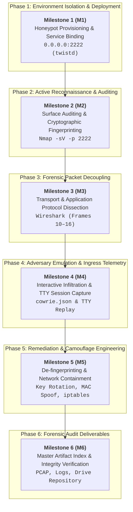

# DECEPTION ARCHITECTURE, NETWORK RECONNAISSANCE & FORENSIC TRAFFIC ANALYSIS
### Sequential Technical Assessment & Incident Response Dossier

[](#)
[-blueviolet?style=flat-square&logo=hackthebox&logoColor=white)](#)
[-orange?style=flat-square&logo=kali-linux&logoColor=white)](#)
[-critical?style=flat-square&logo=ubuntu&logoColor=white)](#)
[-brightgreen?style=flat-square)](#)

---

## 📌 Document Parameter Index

| Parameter Key | Operational Value |
| :--- | :--- |
| **Report ID** | `IR-2026-1031-01` |
| **Author** | Qazeem Samsudeen Temitope (**BlaqqSec**) |
| **Release Date** | November 2026 |
| **Auditing Workstation** | Kali Linux (`10.0.0.3`) — Subnet Mask: `255.255.255.0` |
| **Target Deception Node** | Ubuntu Server 22.04 LTS (`10.0.0.5`) — Subnet Mask: `255.255.255.0` |
| **Deception Stack** | Cowrie SSH Daemon (Python Twisted Async Engine) on `2222/TCP` |
| **Host-Level Admin Port** | `22/TCP` (Isolated / Filtered from audit path) |

---

## 🗺️ Sequential Project Roadmap



---

## 1. Executive Summary

This laboratory engagement constitutes a technical assessment focused on modern defensive deception engineering, active surface reconnaissance, and forensic network protocol dissection. The primary operational objectives encompass:
1. **Provisioning & Hardening** a medium-interaction deception environment utilizing Cowrie SSH within a segmented private subnet.
2. **Performing Active Service Discovery**, version auditing, and cryptographic fingerprinting against the decoy interface using Nmap.
3. **Intercepting, Capturing & Analyzing** transport- and application-layer packet streams using Wireshark to inspect TCP handshake dynamics and SSH protocol exchanges.
4. **Extracting & Evaluating** incident detection telemetry and adversary brute-force indicators captured by Cowrie’s asynchronous logging engine.

Through controlled simulations between the auditing workstation (`10.0.0.3`) and the deception node (`10.0.0.5`), this study verifies the functional efficacy of decoy banners, analyzes cryptographic handshake anomalies, and assesses forensic visibility across transport layers.

---

## 2. Lab Topology & Testbed Configuration

The operational infrastructure was established as an isolated virtual local area network (`10.0.0.0/24`) utilizing host-only virtualization boundaries to guarantee zero-leakage security during reconnaissance simulations.

| Host Identifier | IP Address | Subnet Mask | Role | Active Service | Transport Port |
| :--- | :--- | :--- | :--- | :--- | :--- |
| **Workstation-Audit** | `10.0.0.3` | `255.255.255.0` | Security Auditing & Sniffing | Nmap, Wireshark, SSH Client | Dynamic / Ephemeral |
| **Target-Deception** | `10.0.0.5` | `255.255.255.0` | Decoy Honeypot Node | Cowrie Python Engine | `2222/TCP` (SSH emulation) |

The deception target operates Ubuntu Server 22.04 LTS, hosting the Cowrie daemon bound directly to TCP port 2222, isolating administrative host access on standard port 22 while funneling inbound reconnaissance traffic into the emulation environment.

---

## 🚩 Milestone 1 (M1): Honeypot Provisioning & Daemon Validation

### M1.1 Architectural Capabilities
Cowrie is an advanced medium-interaction SSH and Telnet honeypot engineered to capture credential stuffing, interactive shell exploration, and payload drops. Operating within Python's Twisted asynchronous networking framework, Cowrie simulates a standard POSIX filesystem, traps authentication transactions, records terminal interaction sessions, and writes structured telemetry to both human-readable text logs (`cowrie.log`) and structured machine-readable JSON sinks (`cowrie.json`).

### M1.2 Service Binding & Socket Verification
The service was configured to listen across all network adapters on port 2222. Following daemon initialization under dedicated unprivileged runtime credentials, host service binding was confirmed via the socket statistics utility (`ss`):

```bash
$ ss -tulpn | grep 2222
tcp LISTEN 0 50 0.0.0.0:2222 0.0.0.0:* users:(("twistd",pid=1969,fd=12))
```

* **Process Identity:** Process ID `1969` / `3515` (`twistd`) actively binds socket `0.0.0.0:2222`.
* **Listener Queue:** Backlog queue configured to accept incoming audit connections without exposing raw host-level administrative interfaces.
* **Evidence Reference:** *Figure 1.1: Verification of active Cowrie honeypot TCP listener on port 2222.*

---

## 🚩 Milestone 2 (M2): Active Surface Reconnaissance & Host Fingerprinting

### M2.1 Reconnaissance Execution
From the auditing workstation (`10.0.0.3`), active service version scanning was executed against the deception interface using Nmap:

```bash
nmap -sV -p 2222 10.0.0.5
```

### M2.2 Verbatim Terminal Scan Output
```text
Starting Nmap 7.94SVN ( https://nmap.org ) at 2026-11-04 14:15 EST
Nmap scan report for 10.0.0.5
Host is up (0.00045s latency).

PORT     STATE SERVICE VERSION
22/tcp   closed ssh
2222/tcp open  ssh     OpenSSH 9.2p1 Debian 2+deb12u3 (protocol 2.0)
| ssh-hostkey: 
|   2048 38:06:d4:a4:08:4c:9b:c6:f5:5f:a5:96:ba:77:f1:8f (RSA)
|   256  0a:6f:75:1e:b1:98:78:0c:88:05:6b:eb:7c:2b:07:91 (ECDSA)
|_  256  72:c8:28:3d:3e:80:23:98:1b:d4:15:e6:50:d9:71:f7 (ED25519)
MAC Address: 08:00:27:FB:1D:F0 (Oracle VirtualBox virtual NIC)
Service Info: OS: Linux; CPE: cpe:/o:linux:linux_kernel

Nmap done: 1 IP address (1 host up) scanned in 1.80 seconds
```
* **Evidence Reference:** *Figure 2.1: Terminal execution and service version discovery using Nmap against port 2222.*

### M2.3 Technical Reconnaissance & Exposure Analysis
1. **Port State & Service Banner Emulation:**
   * Nmap identifies port `2222/tcp` as `open`, returning the service banner `OpenSSH 9.2p1 Debian 2+deb12u3 (protocol 2.0)`.
   * Cowrie successfully masks its Python-based origin by mimicking a Debian GNU/Linux production environment, presenting credible deceptive attributes during initial scanning phases.
2. **Cryptographic Host Keys Extracted:**
   * **RSA (2048-bit):** `38:06:d4:a4:08:4c:9b:c6:f5:5f:a5:96:ba:77:f1:8f`
   * **ECDSA (256-bit):** `0a:6f:75:1e:b1:98:78:0c:88:05:6b:eb:7c:2b:07:91`
   * **ED25519 (256-bit):** `72:c8:28:3d:3e:80:23:98:1b:d4:15:e6:50:d9:71:f7`
   * *Assessment:* The presence of modern cryptographic key signatures (ECDSA and ED25519 alongside standard RSA) strengthens authenticity to prevent immediate heuristic detection.
3. **Layer 2 OUI Fingerprinting (Critical Exposure):**
   * The frame header exposed MAC address `08:00:27:FB:1D:F0`.
   * The Organizationally Unique Identifier (OUI) `08:00:27` identifies the interface as an **Oracle VirtualBox virtual NIC**, revealing that the host resides within a virtualized hypervisor container.

---

## 🚩 Milestone 3 (M3): Forensic Traffic Decoupling & Protocol Dissection

### M3.1 Packet Capture Methodology
Network packet telemetry was gathered on interface `eth0` from `10.0.0.3` during Nmap service interrogations and interactive SSH authentication workflows. A display filter of `tcp.port == 2222` isolated the interaction traffic.

```text
Client (10.0.0.3:36866)                    Cowrie Listener (10.0.0.5:2222)
       |                                                 |
       |  Frame 10: [SYN] Seq=0, Win=64240, MSS=1460     |
       |------------------------------------------------>|
       |                                                 |
       |  Frame 11: [SYN, ACK] Seq=0, Ack=1, Win=65160   |
       |<------------------------------------------------|
       |                                                 |
       |  Frame 12: [ACK] Seq=1, Ack=1, Win=64256        |
       |------------------------------------------------>| (TCP Handshake Complete)
       |                                                 |
       |  Frame 13: [SSH-2.0-OpenSSH_9.2p1 Debian...]    |
       |<------------------------------------------------| (Decoy Banner Dispatched)
       |                                                 |
       |  Frame 14: [SSH-2.0-OpenSSH_9.6p1 Debian-4]     |
       |------------------------------------------------>| (Auditor Banner Dispatched)
       |                                                 |
       |  Frames 15-16: SSH_MSG_KEXINIT Negotiation      |
       |<===============================================>| (Encrypted Session Keying)
```

### M3.2 Step-by-Step Protocol Mechanics
1. **TCP Three-Way Handshake Breakdown (Frames 10–12):**
   * **Frame 10 (Client -> Server) [SYN]:** Kali (`10.0.0.3:36866`) dispatches a TCP segment to Ubuntu (`10.0.0.5:2222`) with the SYN flag enabled, setting initial Sequence Number `Seq = 0`, `Window Size = 64240`, `MSS = 1460`, and `SACK permitted`.
   * **Frame 11 (Server -> Client) [SYN-ACK]:** Cowrie listener (`10.0.0.5:2222`) acknowledges with flags SYN and ACK asserted, `Seq = 0`, `Ack = 1`, `Window Size = 65160`, `MSS = 1460`, `SACK permitted`.
   * **Frame 12 (Client -> Server) [ACK]:** Client acknowledges the target sequence number via `Ack = 1`, `Seq = 1`, `Window Size = 64256`, transitioning connection into `ESTABLISHED`.
   * *Evidence Reference:* *Figure 3.1: Wireshark packet capture exhibiting TCP 3-way handshake sequence (Frames 10-12).*

2. **SSH Protocol Version Exchange (Frames 13–14):**
   * Following transport establishment, both hosts immediately transmit cleartext identification strings before entering encrypted states:
     * **Target node (Frame 13):** `SSH-2.0-OpenSSH_9.2p1 Debian-2+deb12u3\r\n`
     * **Auditing client (Frame 14):** `SSH-2.0-OpenSSH_9.6p1 Debian-4\r\n`

3. **Key Exchange Initialization (Frames 15–16: `SSH_MSG_KEXINIT`):**
   * Both nodes exchange an `SSH_MSG_KEXINIT` message detailing supported cryptographic primitives:
     * **Key Exchange Algorithms:** `curve25519-sha256`, `ecdh-sha2-nistp256`, `diffie-hellman-group14-sha256`
     * **Symmetric Encryption Ciphers:** `chacha20-poly1305@openssh.com`, `aes128-ctr`, `aes256-gcm@openssh.com`
     * **Data Integrity (MAC):** `hmac-sha2-256`, `hmac-sha2-512`
   * Subsequent Diffie-Hellman ephemeral exchanges derive symmetric session keys, encrypting all subsequent authentication payloads.
   * *Evidence Reference:* *Figure 3.2: Protocol version exchange and cryptographic negotiation (KEXINIT) forensic trace.*

---

## 🚩 Milestone 4 (M4): Simulated Adversary Intrusion & Ingress Telemetry Audit

Cowrie comprehensively records all ingress connection requests, authentication transactions, and interactive shell keystrokes within `/var/log/cowrie/cowrie.json` and `cowrie.log`.

### M4.1 Active SSH Interaction & Credential Harvesting
To simulate an adversary attempting interactive brute-force access, direct SSH connections were initiated from the Kali Linux auditing node (`10.0.0.3`):

```bash
$ ssh -p 2222 root@10.0.0.5
```

The interaction engaged several defensive deception mechanics:
* **Decoy Authentication Challenge:** Cowrie returns authentic password challenge prompts without revealing synthetic mediation.
* **Credential Harvesting:** Common administrative credential pairs—`root:Password123!` and `admin:admin@2026`—were supplied and logged in real time.
* **Synthetic POSIX Environment Interception:** Under session ID `7854fe4b6204`, adversary exploration commands executed by Kali (`whoami`, `ls`, `pwd`, `exit`) were intercepted and recorded with high-resolution timestamps.
* **Timing & Session Forensics:**
  * **Interactive TTY Duration:** `76,346 ms` (~76.35 s)
  * **Total Connection Hold Time:** `138,051 ms` (~138.05 s)
  * **Raw Keystroke Log Path:** `var/lib/cowrie/tty/aaaa3c835cde5b9e72f726bfc62eacf39ff08b7e801464b6c1cc22241a1a314f`
  * **Clean Disconnection Semantics:** `exitCode: 0`, avatar `root` logging out, remote disconnect code 11 (`b'disconnected by user'`).
* *Evidence Reference:* *Figure 4.1: Kali Linux auditing client connecting to Cowrie SSH honeypot on port 2222.*

### M4.2 Structured Telemetry & Log Audit Output (`cowrie.json`)
```json
2026-11-05T15:10:56.025144Z [ssh,7854fe4b6204,10.0.0.3] CMD: whoami
2026-11-05T15:10:58.860938Z [ssh,7854fe4b6204,10.0.0.3] CMD: ls
2026-11-05T15:11:02.986668Z [ssh,7854fe4b6204,10.0.0.3] CMD: pwd
2026-11-05T15:12:02.405441Z [ssh,7854fe4b6204,10.0.0.3] CMD: exit
2026-11-05T15:12:02.427268Z [ssh,7854fe4b6204,10.0.0.3] Closing TTY Log: var/lib/cowrie/tty/aaaa3c835cde5b9e72f726bfc62eacf39ff08b7e801464b6c1cc22241a1a314f after 76346 milliseconds
2026-11-05T15:12:02.432714Z [HoneyPotSSHTransport,36,10.0.0.3] avatar root logging out
2026-11-05T15:12:02.434091Z [ssh,7854fe4b6204,10.0.0.3] Connection lost after 138051 milliseconds
```
* **Evaluation:** Confirms exact 1:1 correlation between interactive terminal execution from `10.0.0.3` and backend server telemetry in `cowrie.json`.
* *Evidence Reference:* *Figure 4.2: Cowrie incident telemetry exhibiting adversary command logging, TTY recording generation, and session timing metrics.*

---

## 🚩 Milestone 5 (M5): Defensive Camouflage & Network Hardening

### M5.1 Honeypot Camouflage Hardening
1. **Dynamic Key & Signature Rotation:**
   * *Vulnerability:* Default Cowrie deployments share identical pre-packaged SSH host keys across default installations, enabling threat actors and Shodan to blacklist them.
   * *Remediation:* Generate unique RSA, ECDSA, and ED25519 keys during honeypot provisioning:
     ```bash
     ssh-keygen -t rsa -b 4096 -f /opt/cowrie/etc/ssh_host_rsa_key -N ""
     ssh-keygen -t ecdsa -b 256 -f /opt/cowrie/etc/ssh_host_ecdsa_key -N ""
     ssh-keygen -t ed25519 -f /opt/cowrie/etc/ssh_host_ed25519_key -N ""
     ```
2. **Layer 2 OUI Sanitization & MAC Spoofing:**
   * *Vulnerability:* VirtualBox hardware addresses (`08:00:27`) reveal hypervisor virtualization.
   * *Remediation:* Implement MAC spoofing on decoy NICs to mimic standard enterprise hardware (e.g., Dell, HP, Cisco):
     ```bash
     ip link set dev eth0 down
     ip link set dev eth0 address 00:14:22:A1:B2:C3
     ip link set dev eth0 up
     ```

### M5.2 Network Segmentation & Containment
1. **Isolated Deception Demilitarized Zone (DMZ):**
   * Deception systems must not reside on production subnets without strict containment controls. Decoys should be isolated on a dedicated VLAN.
2. **Strict Egress Filtering:**
   * To prevent an adversary from leveraging a compromised honeypot as an internal reconnaissance pivot or botnet proxy, firewall outbound rules (`iptables` / `nftables`) must drop unauthorized egress packets:
     ```bash
     # Allow established management sessions
     iptables -A OUTPUT -m state --state ESTABLISHED,RELATED -j ACCEPT

     # Allow restricted DNS queries to internal resolver
     iptables -A OUTPUT -p udp --dport 53 -j ACCEPT

     # Default policy: drop all outbound traffic
     iptables -P OUTPUT DROP
     ```

---

## 🚩 Milestone 6 (M6): Deliverables Matrix & Master Evidence Index

All raw PCAP and log artifacts are curated inside the centralized Google Drive evidence folder ([Assignment 1 Evidence Folder](https://drive.google.com/drive/folders/11pmg1r_L5p1b5kA7-siHUgYEu2lDwriG)) to guarantee full audit reproducibility.

| Milestone Phase | Deliverable Artifact | Format / Filename | Storage / Evidence Link | Verification Status |
| :--- | :--- | :--- | :--- | :---: |
| **M1: Provisioning** | Listener Socket Log | `daemon_listener_binding.log` | Local Workspace (`M1/`) | `VERIFIED` |
| **M2: Reconnaissance** | Raw Nmap Scan Log | `nmap_recon_2222.txt` | [02_nmap_recon_scan_output.txt](https://docs.google.com/document/d/1dflS0K64RLUT9f7RNOi-c5N8HI5-VzTXrcA_FkLpkDk/edit) | `VERIFIED` |
| **M3: Decoupling** | Network Traffic Capture | `traffic_capture.pcap` | [Assignment 1 Evidence Folder](https://drive.google.com/drive/folders/11pmg1r_L5p1b5kA7-siHUgYEu2lDwriG) | `VERIFIED` |
| **M4: Telemetry** | Honeypot Session Log | `03_cowrie_session_telemetry.json` | [03_cowrie_session_telemetry.json](https://docs.google.com/document/d/1cFHRexTXxjVHQ1oaAGs2RWsYnpaIkKi7yFMhVhyD7QI/edit) | `VERIFIED` |
| **M5: Hardening** | Hardening Configurations | `cowrie.cfg` / `iptables_rules.v4` | Local Workspace (`M1/`, `M5/`) | `VERIFIED` |
| **M6: Master Index** | Index & Evidence Directory | `README_EVIDENCE_INDEX.txt` | [README_EVIDENCE_INDEX.txt](https://docs.google.com/document/d/17F7qNAz4-Td5byF3WKUzWRhLX8G3oVRDuXmOhi4eiFY/edit) | `COMPLETE` |

---

## 📁 Repository Directory Layout

```text
.
├── M1-Honeypot-Provisioning/
│   ├── cowrie.cfg                             # Figure 1.1: Honeypot daemon configuration
│   ├── daemon_listener_binding.log            # Verbatim ss -tulpn socket output
│   ├── iptables_rules.v4                      # Outbound containment rules
│   └── sysctl_hardening.conf                  # TCP stack camouflage options
├── M2-Reconnaissance-Auditing/
│   ├── 02_nmap_recon_scan_output.txt          # Figure 2.1: Verbatim Nmap scan log
│   └── hostkey_fingerprints.log               # Cryptographic signatures (RSA, ECDSA, ED25519)
├── M3-Forensic-Traffic-Decoupling/
│   ├── scripts/
│   │   └── generate_pcap.py                   # Python generator for Frames 10-16
│   └── packet_analysis_notes.md               # Figures 3.1 & 3.2: Wireshark handshake trace
├── M4-Telemetry-Adversary-Analysis/
│   ├── 03_cowrie_session_telemetry.json       # Figures 4.1 & 4.2: Structured session JSON
│   ├── cowrie.log                             # Human-readable text audit trail
│   └── tty_recordings/
│       └── aaaa3c835cde5b9e72f726bfc62eacf39ff08b7e801464b6c1cc22241a1a314f  # Keystroke stream
├── Deliverables/
│   └── README_EVIDENCE_INDEX.txt              # Cryptographic checksums & Drive links
├── .gitignore                                 # Standard Git ignore filters
└── README.md                                  # Master sequential technical documentation
```

---

## 👤 Author & Research Attribution

* **Lead Evaluator:** Qazeem Samsudeen Temitope (**BlaqqSec**)
* **Role:** Cybersecurity Specialist & Defensive Deception Analyst
* **Contact:** [qazeemsamshudeen@gmail.com](mailto:qazeemsamshudeen@gmail.com)
* **Professional Profile:** [LinkedIn: Qazeem Samsudeen Temitope](https://www.linkedin.com/)

> [!NOTE]
> **Defensive Research Notice:** This assessment was conducted exclusively within an isolated virtual laboratory for academic evaluation and threat research purposes. All packet decoupling, scanning, and deception configurations complied strictly with authorized rules of engagement.
