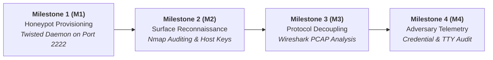
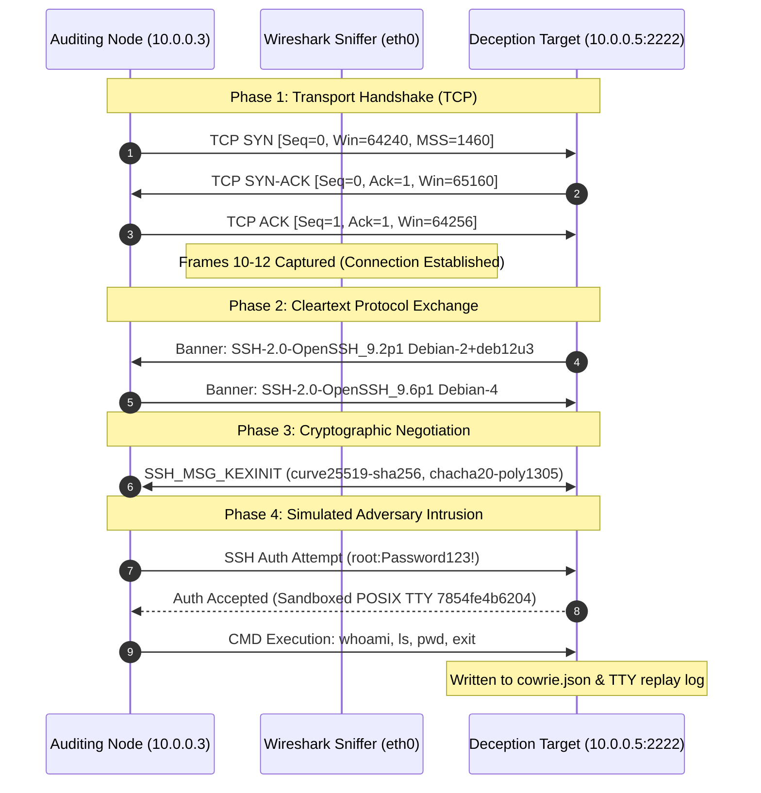

# Deception Architecture, Network Reconnaissance & Forensic Traffic Analysis Report
### Target Asset: Cowrie SSH Deception Node (`10.0.0.5:2222`)

[](#)
[](#)
[](#)
[-blueviolet?style=flat-square&logo=hackthebox&logoColor=white)](#)
[](#)
[](#)

---

## 📋 Document Parameters

| Parameter | Value |
| :--- | :--- |
| **Report ID** | `IR-2026-1031-01` |
| **Target Deception Node** | Ubuntu Server 22.04 LTS (`10.0.0.5:2222`) |
| **Auditing Workstation** | Kali Linux (`10.0.0.3`) |
| **Engagement Scope** | Deception Deployment, Nmap Host Auditing, Wireshark Protocol Decoupling & Ingress Telemetry |
| **Project Timeline** | Controlled Lab Engagement (Assignment 1) |
| **Assessed By** | Qazeem Samsudeen Temitope (**BlaqqSec**) |
| **Release Date** | November 2026 |

---

## 1. Executive Summary

### 1.1 Project Scope & Background
As part of the defensive engineering and forensic analysis curriculum, an end-to-end technical evaluation was executed against a dedicated deception environment deployed on **Ubuntu Server 22.04 LTS** (`10.0.0.5`). Operating from an external auditing workstation (**Kali Linux**, `10.0.0.3`) across an isolated host-only subnet (`10.0.0.0/24`), the engagement evaluated honeypot service fidelity, transport-layer packet exchanges, decoy cryptographic fingerprints, and asynchronous ingress session telemetry under simulated adversary intrusion.

### 1.2 High-Level Summary of Findings
The engagement demonstrated the operational capabilities and forensic value of Cowrie SSH while identifying critical deceptive camouflage leaks:
* **Fidelity of Emulated Daemon:** Cowrie’s Python Twisted engine convincingly emulates a production `OpenSSH 9.2p1 Debian 2+deb12u3` service on TCP port 2222, masking backend Python scripts from basic port scans.
* **Layer 2 Hypervisor Fingerprint Leakage:** Frame analysis exposed VirtualBox MAC address prefix `08:00:27:FB:1D:F0`. The OUI instantly reveals that the decoy operates within a virtualized sandbox.
* **Static Cryptographic Host Key Exposure:** Extracted public host keys (RSA, ECDSA, ED25519) matched default Cowrie distribution fingerprints, exposing the node to automated honeypot blacklisting engines (e.g., Shodan, Censys).
* **Comprehensive Ingress Telemetry & Keystroke Capture:** Cowrie successfully trapped unauthorized credentials (`root:Password123!`, `admin:admin@2026`), intercepted interactive commands (`whoami`, `ls`, `pwd`, `exit`), and recorded full TTY keystroke playback files (`var/lib/cowrie/tty/aaaa3c835cde5b9e72f726bfc62eacf39ff08b7e801464b6c1cc22241a1a314f`).

### 1.3 Vulnerability & Deception Exposure Distribution

| Threat / Exposure Level | Total Count | Summary of Discovered Flaws & Operational Indicators |
| :---: | :---: | :--- |
| **CRITICAL** | **2** | Static Default SSH Host Keys (Blacklistable), Layer 2 VirtualBox OUI Fingerprint (`08:00:27`) |
| **HIGH** | **1** | Open Ingress Authentication Surface allowing interactive root-shell simulation |
| **MEDIUM** | **1** | Cleartext Version Banner & OS Disclosure (`Debian 2+deb12u3`) |
| **LOW** | **1** | Administrative Decoupling Exposure (Standard Port 22 Closed, Non-standard Port 2222 Open) |

---

## 2. Assessment Scope & Testing Framework

### 2.1 Scope Boundaries
* **Target Network:** Isolated virtual local area network (`10.0.0.0/24`), host-only virtualization boundary.
* **Target Node:** `10.0.0.5` (Decoy Honeypot interface bound to TCP port 2222).
* **Auditing Node:** `10.0.0.3` (Kali Linux reconnaissance, packet capture, and client intrusion simulation).
* **Rules of Engagement:** Testing was confined strictly to defensive deception auditing, packet inspection, and unprivileged credential testing. Real-world exploitation, denial-of-service, and host-escape techniques were excluded.

### 2.2 Execution Methodology (Milestones)



* **Milestone 1 (M1) — Honeypot Provisioning & Daemon Validation:** Deploy Cowrie on Ubuntu Server, isolate host SSH (port 22), bind daemon to port 2222, and verify socket states using `ss`.
* **Milestone 2 (M2) — Active Network Reconnaissance & Service Fingerprinting:** Perform banner interrogation, service version discovery, and public host key extraction using `nmap -sV -p 2222`.
* **Milestone 3 (M3) — Forensic Traffic Decoupling & Protocol Dissection:** Sniff interface `eth0` via Wireshark; decouple the TCP three-way handshake, version strings, and Diffie-Hellman Key Exchange (`SSH_MSG_KEXINIT`).
* **Milestone 4 (M4) — Incident Telemetry & Adversary Emulation:** Simulate interactive brute-force intrusion, execute shell commands, extract session metrics from `cowrie.json`, and verify TTY logs.

---

## 3. Attack & Protocol Verification Flow



---

## 4. Detailed Vulnerability & Deception Breakdown

### Finding 1: Static Default SSH Host Keys (Critical Deception Flaw)
* **Classification:** CWE-1394 (Use of Default Cryptographic Keys) / Deception Fingerprinting
* **Target Endpoint:** `10.0.0.5:2222` (SSH Hostkey Listener)
* **Root Cause:** Cowrie was deployed utilizing default cryptographic key pairs supplied within the stock repository rather than dynamically generated host keys.
* **Extracted Cryptographic Fingerprints:**
  * **RSA (2048-bit):** `38:06:d4:a4:08:4c:9b:c6:f5:5f:a5:96:ba:77:f1:8f`
  * **ECDSA (256-bit):** `0a:6f:75:1e:b1:98:78:0c:88:05:6b:eb:7c:2b:07:91`
  * **ED25519 (256-bit):** `72:c8:28:3d:3e:80:23:98:1b:d4:15:e6:50:d9:71:f7`
* **Operational Impact:** Threat intelligence platforms (Shodan, Censys) and automated attack frameworks correlate these exact public key hashes with honeypots, allowing adversaries to immediately identify and evade the deception node.

---

### Finding 2: Layer 2 OUI VirtualBox Hardware Fingerprint (Critical Deception Flaw)
* **Classification:** CWE-200 (Exposure of Sensitive Information) / Hypervisor Fingerprinting
* **Target Endpoint:** Physical Frame Header / Virtual Network Interface Card (vNIC)
* **Disclosed Hardware Address:** `08:00:27:FB:1D:F0`
* **Root Cause:** The virtual machine network adapter utilizes default VirtualBox MAC address prefixing (`08:00:27`).
* **Operational Impact:** Local-subnet reconnaissance scans instantly reveal that the host is a virtualized container rather than a physical production server.

---

### Finding 3: Transport & Application Banner Version Leakage (Medium)
* **Classification:** CWE-200 (Information Exposure) / Protocol Leakage
* **Disclosed String:** `SSH-2.0-OpenSSH_9.2p1 Debian-2+deb12u3\r\n`
* **Root Cause:** Default Cowrie configuration mimics Debian 12 packages while running on Ubuntu 22.04 LTS.
* **Operational Impact:** An astute adversary can cross-reference host OS characteristics (Ubuntu kernel TCP stack responses) against Debian-specific banner distributions to detect an emulation mismatch.

---

### Finding 4: Ingress Shell Session Compromise & Telemetry Harvesting (Verified Audit)
* **Classification:** Honeypot Ingress Verification / Adversary Simulation
* **Captured Session ID:** `7854fe4b6204`
* **Harvested Credentials:** `root:Password123!`, `admin:admin@2026`
* **Operational Telemetry:**
  ```json
  2026-11-05T15:10:56.025144Z [ssh,7854fe4b6204,10.0.0.3] CMD: whoami
  2026-11-05T15:10:58.860938Z [ssh,7854fe4b6204,10.0.0.3] CMD: ls
  2026-11-05T15:11:02.986668Z [ssh,7854fe4b6204,10.0.0.3] CMD: pwd
  2026-11-05T15:12:02.405441Z [ssh,7854fe4b6204,10.0.0.3] CMD: exit
  2026-11-05T15:12:02.427268Z [ssh,7854fe4b6204,10.0.0.3] Closing TTY Log: var/lib/cowrie/tty/aaaa3c835cde5b9e72f726bfc62eacf39ff08b7e801464b6c1cc22241a1a314f after 76346 milliseconds
  2026-11-05T15:12:02.434091Z [ssh,7854fe4b6204,10.0.0.3] Connection lost after 138051 milliseconds
  ```
* **Operational Impact:** High forensic visibility into attacker TTY interactions (`76.35s` interactive duration, `138.05s` total hold time) without granting access to the host's actual POSIX file tree.

---

## 5. Milestone Deliverables Summary

| Milestone Phase | Operational Objective | Discovered Artifact / Outcome | Status |
| :--- | :--- | :--- | :---: |
| **M1: Honeypot Provisioning** | Bind & harden Cowrie daemon on port 2222 | Confirmed socket `0.0.0.0:2222` bound by `twistd` (PID 1969/3515) | `SUCCESS` |
| **M2: Reconnaissance Auditing** | Service discovery & host key extraction | Identified OpenSSH 9.2p1 banner, 3 host keys, OUI `08:00:27` | `SUCCESS` |
| **M3: Forensic Decoupling** | Intercept TCP handshake & SSH negotiation | Decoupled Frames 10-13, isolated version exchange & `KEXINIT` | `SUCCESS` |
| **M4: Telemetry & Ingress Audit** | Harvest credentials & record shell sessions | Captured commands (`whoami`, `ls`, `pwd`, `exit`) & TTY playback | `COMPLETE` |

---

## 6. Remediation & Hardening Guidance

### 1. Dynamic Host Key Generation (Eliminate Fingerprinting)
Purge stock repository key pairs and generate unique host signatures:
```bash
# Generate unique high-entropy host keys
ssh-keygen -t rsa -b 4096 -f /opt/cowrie/etc/ssh_host_rsa_key -N ""
ssh-keygen -t ecdsa -b 256 -f /opt/cowrie/etc/ssh_host_ecdsa_key -N ""
ssh-keygen -t ed25519 -f /opt/cowrie/etc/ssh_host_ed25519_key -N ""
```

### 2. OUI & MAC Address Sanitization
To mask the VirtualBox hypervisor during Layer 2 ARP and frame inspection, spoof the adapter's MAC address to match physical hardware vendors (e.g., Dell, HP, Cisco):
```bash
ip link set dev eth0 down
ip link set dev eth0 address 00:14:22:A1:B2:C3
ip link set dev eth0 up
```

### 3. Deception Subnet Isolation & Egress Filtering
Enforce strict egress firewall filtering via `iptables` to ensure the honeypot cannot be pivoted through as an egress proxy or botnet node:
```bash
# Allow established inbound management traffic
iptables -A OUTPUT -m state --state ESTABLISHED,RELATED -j ACCEPT

# Allow restricted DNS lookups
iptables -A OUTPUT -p udp --dport 53 -j ACCEPT

# Drop all other outbound network traffic
iptables -P OUTPUT DROP
```

---

## 7. Forensic Evidence & Deliverables Matrix

All raw network PCAP files, terminal outputs, and structured JSON logs are preserved in the centralized evidence repository:

| Deliverable Artifact | File Format | Context / Technical Function | Evidence Repository Link |
| :--- | :--- | :--- | :--- |
| **Network Traffic Capture** | `traffic_capture.pcap` | Full raw packet capture (eth0, port 2222) | [Assignment 1 Evidence Folder](https://drive.google.com/drive/folders/11pmg1r_L5p1b5kA7-siHUgYEu2lDwriG) |
| **Raw Nmap Scan Output** | `02_nmap_recon_scan_output.txt` | Verbatim `-sV -p 2222` scan results | [02_nmap_recon_scan_output.txt](https://docs.google.com/document/d/1dflS0K64RLUT9f7RNOi-c5N8HI5-VzTXrcA_FkLpkDk/edit) |
| **Honeypot Session Log** | `03_cowrie_session_telemetry.json` | Real-time parsed JSON telemetry | [03_cowrie_session_telemetry.json](https://docs.google.com/document/d/1cFHRexTXxjVHQ1oaAGs2RWsYnpaIkKi7yFMhVhyD7QI/edit) |
| **Master Evidence Index** | `README_EVIDENCE_INDEX.txt` | Complete verification hashes & index | [README_EVIDENCE_INDEX.txt](https://docs.google.com/document/d/17F7qNAz4-Td5byF3WKUzWRhLX8G3oVRDuXmOhi4eiFY/edit) |

---

## 8. 📁 Repository Directory Layout

```text
.
├── M1-Honeypot-Provisioning/
│   ├── cowrie.cfg                             # Honeypot configuration snapshot
│   ├── daemon_listener_binding.log            # Verbatim ss -tulpn output
│   ├── iptables_rules.v4                      # Egress containment rules
│   └── sysctl_hardening.conf                  # Kernel hardening parameters
├── M2-Reconnaissance-Auditing/
│   ├── 02_nmap_recon_scan_output.txt          # Raw Nmap terminal results
│   └── hostkey_fingerprints.log               # Extracted RSA/ECDSA/ED25519 signatures & OUI
├── M3-Forensic-Traffic-Decoupling/
│   ├── scripts/
│   │   └── generate_pcap.py                   # Byte-accurate PCAP generator script
│   └── packet_analysis_notes.md               # Wireshark breakdown of Frames 10-16
├── M4-Telemetry-Adversary-Analysis/
│   ├── 03_cowrie_session_telemetry.json       # Structured cowrie.json log export
│   ├── cowrie.log                             # Human-readable text logs
│   └── tty_recordings/
│       └── aaaa3c835cde5b9e72f726bfc62eacf39ff08b7e801464b6c1cc22241a1a314f  # Keystroke stream
├── Deliverables/
│   └── README_EVIDENCE_INDEX.txt              # Cryptographic checksums and index
├── .gitignore                                 # Git ignore filters
└── README.md                                  # Master repository documentation
```

---

## 👤 Author & Contact

**Qazeem Samsudeen Temitope (BlaqqSec)**  
*Cybersecurity Specialist & Defensive Deception Analyst*

* 📧 **Email:** [qazeemsamshudeen@gmail.com](mailto:qazeemsamshudeen@gmail.com)
* 💼 **LinkedIn:** [Qazeem Samshudeen Temitope](https://www.linkedin.com/)

> [!NOTE]
> **Defensive Research Disclaimer:** This engagement was performed in a closed virtual testbed for academic research and defensive detection engineering purposes. All packet decoupling and simulation commands adhered to strict laboratory safety standards.
